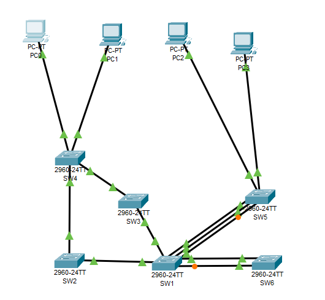
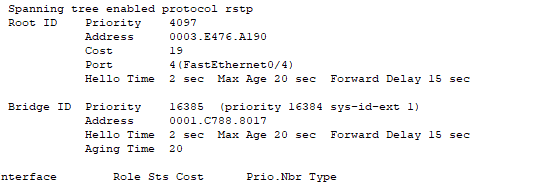
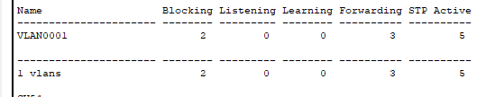
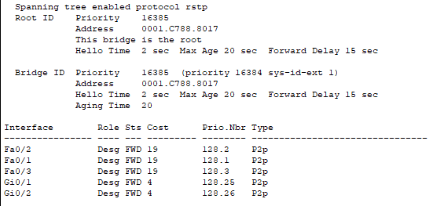
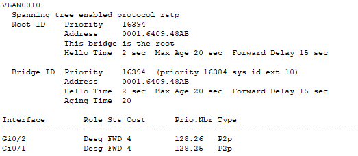
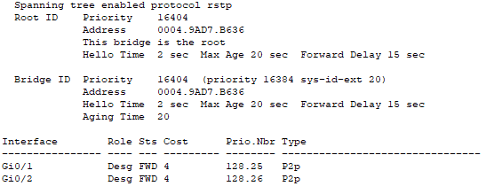
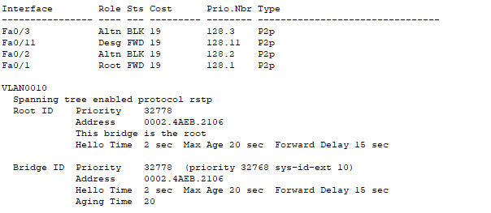
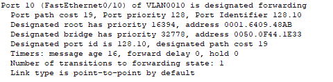
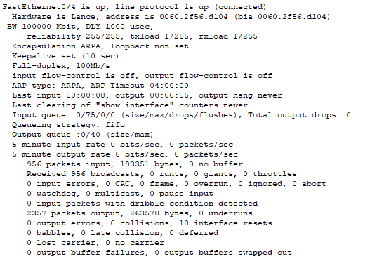
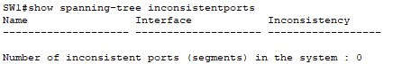

# Отчет по лабораторной работе №4
**Тема:** STP
**Выполнил:** Кочеров Евгений, Денисенко Максим, Зеленцова Варвара. гр. 539  

## Топология



## Ответы на вопросы

1. SW1 рутовый т.к у него меньше priority 
2. 
```
configure terminal
spanning-tree mode rapid-pvst
end
copy running-config startup-config
```
3. STP работает в rapid-pvst 
4. SW1
SW2
SW3
5. FastEthernet 0/1
Root Path Cost — наименьшая
При равенстве — Bridge ID вышестоящего коммутатора — наименьший
При равенстве — Port ID вышестоящего — наименьший
При равенстве — локальный Port ID — наименьший
6. Для VLAN 10 - SW1 Fa0/2,
для VLAN 20 - Fa0/3,.
Для VLAN 1 корневой порт определяется стандартным сравнением стоимости пути.

7.   чтобы перевести магистральный интерфейс в режим Portfast - spanning-tree portfast trunk
8.   интерфейс работает исправно
9.   Нету никаких интерфейсов